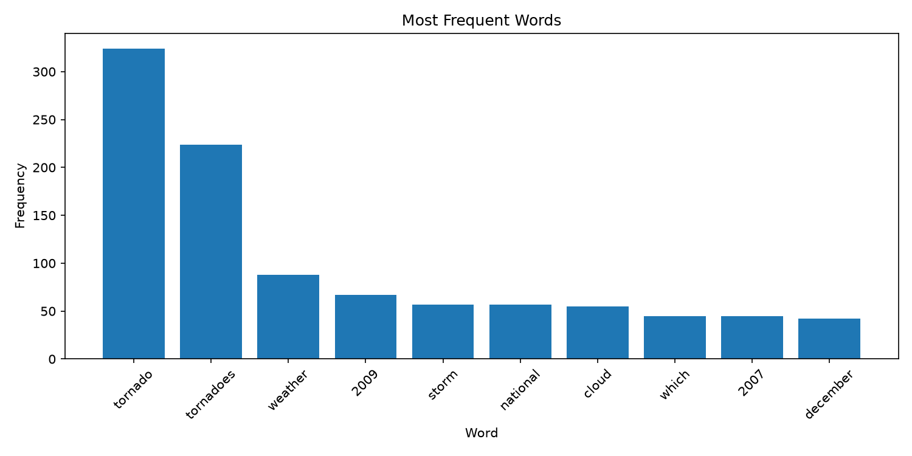
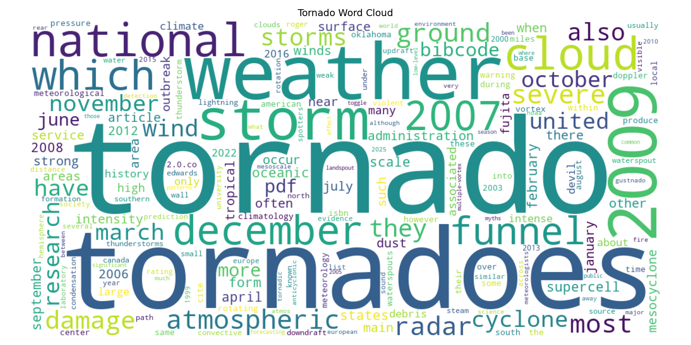

# nlp-01-severe-weather

> Retrieve, process, and visualize text about tornadoes and severe weather using Python.

## Project Overview

Author: Beth Spornitz

Date: 2026 October

First project in the Web Mining and Applied NLP course.

This project explores web mining and natural language processing (NLP) using Python.

The goal is to analyze text from Wikipedia articles about tornadoes and other severe weather events. The project will use text cleaning, word frequency analysis, and visualizations to identify common patterns.

The project is based on Denise Case's NLP Getting Started example and will be customized based on the assignment.

The project is configured in [pyproject.toml](pyproject.toml).


## Data

This project retrieves text from the [Wikipedia article about tornadoes](https://en.wikipedia.org/wiki/Tornado) using Python and the Requests library.

BeautifulSoup parses the HTML and extracts the text for analysis.

The article provides information about tornado characteristics, formation, weather conditions, and impacts.

No local input dataset is required because the script retrieves the article directly from Wikipedia.

## Approach

This project uses Python to retrieve and analyze text from Wikipedia's tornado article.

The analysis includes:

- Retrieving HTML using Requests.
- Parsing HTML and extracting text with BeautifulSoup.
- Converting words to lowercase and removing punctuation.
- Filtering selected common words and Wikipedia reference terms.
- Calculating word frequencies using Polars.
- Creating a bar chart with Matplotlib.
- Generating a word cloud to visualize frequently used terminology.

The custom stop-word filter improves the analysis by removing words that do not contribute meaningful information about tornadoes. Months are intentionally retained because seasonal terminology may be relevant to severe weather research.

## Run the Project

Follow the [Professional Python Workflow Guide](https://denisecase.github.io/pro-analytics-02/)
to set up your machine and project environment.

From a VS Code terminal in the project root:

```shell
uv run python -m nlp.web_words
```

Close each visualization window after viewing
so the script can continue executing.

The Jupyter notebook provides an additional
interactive version of the analysis.

## Results

The tornado article analysis produced the following results:

- **15,744** raw words extracted from the article.
- **9,706** words after initial cleaning.
- **9,032** words remaining after custom stop-word filtering.

The most frequent terms included:

| Word | Frequency |
|---|---:|
| tornado | 324 |
| tornadoes | 224 |
| weather | 88 |
| storm | 57 |
| cloud | 55 |
| radar | 35 |
| damage | 34 |

The results highlight terminology related to tornado formation, weather conditions, and impacts.

### Tornado Word Frequency Chart



### Tornado Word Cloud



The visualizations provide two ways to explore the article's most frequently used words.

**Limitation:** Word frequencies reflect how often terms appear in the Wikipedia article, not how frequently tornadoes occur in the real world.

Successful execution displays:

```text
Pipeline executed successfully!
```

The script also records execution information in the project log.

## Verification

Run the automated tests:

```shell
uv run python -m pytest
```

## Project Documentation

The [hosted documentation site](https://bethspornitz.github.io/nlp-01-severe-weather/)
is published using Zensical and GitHub Pages.

The documentation site is used to present the project report,
covering such sections as data, methods, results, visualizations,
interpretation, and conclusions.

## CI/CD and GitHub Actions

This project includes continuous integration and continuous deployment (CI/CD)
to check project files and publish the docs.

GitHub Actions include:

- [CI: Python and Documentation Checks](https://github.com/BethSpornitz/nlp-01-severe-weather/actions/workflows/ci-python-zensical.yml)
- [CD: Documentation Deployment](https://github.com/BethSpornitz/nlp-01-severe-weather/actions/workflows/deploy-zensical.yml)


## Developer Reference

Follow the
[Professional Python Workflow Guide](https://denisecase.github.io/pro-analytics-02/)
for **detailed instructions and troubleshooting**.

### Initialize and Update the Python Environment

With the project open in VS Code, open a VS Code terminal.
Paste each command and hit Enter or Return after to run it.

```shell
uvx pup-clean --delete
uv self update
uv python pin 3.14
uv python install
uv lock --upgrade
uv sync
uv audit
```

### Set Up and Run Git Hooks

Set up and run the git hooks to perform
basic checks automatically before
any changes get pushed to GitHub.

In the VS Code terminal,
paste each command and hit Enter or Return after to run it.

```shell
uv run prek install --force
uv run prek update --freeze --cooldown-days 7

git add -A
uv run prek run --all-files
# repeat if changes were made
uv run prek run --all-files
```

### Run Common Chores

Run linters, formatters, type checks, tests, and
build the documentation.

```shell
uv run ruff check . --fix
uv run ruff format .

uv run ty check
uv run python -m pytest
uv run python -m zensical build
```

### Git add-commit-push to GitHub

After making useful changes, save your work to GitHub.

```shell
git add -A
git commit -m "describe your changes in quotes"
git push -u origin main
```

## ## Technical Experiment: Changing the Source Article

**Modification:** I changed the source URL in `web_words.py` from the Wikipedia article about natural language processing to the article about tornadoes.

**Reason:** I wanted to see whether the same text analysis process would work with a different topic.

**Prediction:** I expected weather related words to appear more frequently than natural language processing terms.

**Results:** The script ran successfully. The tornado article contained 15,744 raw words and 9,706 cleaned words. The most frequent words included "tornado" (324), "tornadoes" (224), and "weather" (88).

**What I learned:** The same Python code can analyze different web pages by changing the source URL. I also noticed that some frequent words, such as "retrieved" and "archived," came from Wikipedia references, which suggests the text cleaning process could be improved.


## Developer Notes

- Use the **UP ARROW** and **DOWN ARROW** in the terminal to scroll through past commands.
- Use `CTRL+f` to find (and replace) text within a file.

## Developer Tools

This project uses professional Python tools to support development,
testing, documentation, and code quality.

- [uv](https://docs.astral.sh/uv/) - Python environments and dependencies.
- [Ruff](https://docs.astral.sh/ruff/) - Python linting and formatting, configured in [.ruff.toml](.ruff.toml).
- [ty](https://docs.astral.sh/ty/) - Python type checking.
- [pytest](https://docs.pytest.org/) - automated Python testing, configured in [.pytest.toml](.pytest.toml).
- [prek](https://prek.j178.dev/) - Git hooks and automated checks, configured in [prek.toml](prek.toml).
- [Zensical](https://zensical.org/) - project documentation, configured in [zensical.toml](zensical.toml).


## Links

- [Hosted Documentation](https://bethspornitz.github.io/nlp-01-severe-weather/)
- [Professional Python Workflow Guide](https://denisecase.github.io/pro-analytics-02/)
- [Citation](CITATION.cff)
- [License](LICENSE)
